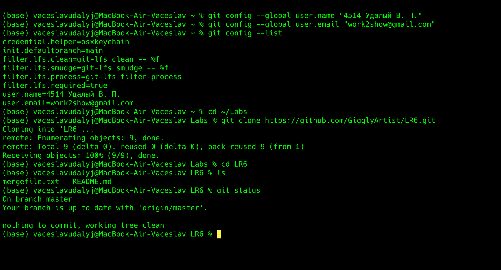
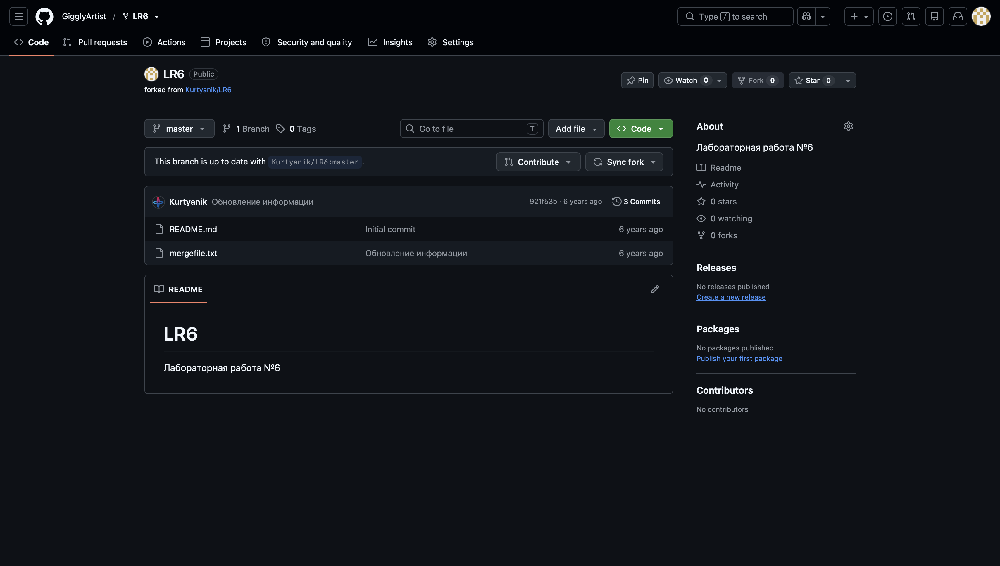
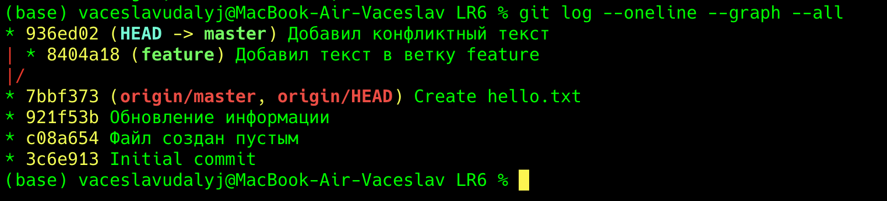

# Отчёт по лабораторной работе №6: Система контроля версий

**Цель лабораторной работы:** изучение базовых возможностей системы управления версиями, опыт работы с Git API, опыт работы с локальным и удаленным репозиториями.

## 1. Снимки экрана

**1. Настройка клиента Git и клонирование репозитория:**


**2. Форк личного репозитория на GitHub:**


**3. Граф веток и история коммитов:**


## 2. Лог команд

```bash
git config --global user.name "4514 Удалый В. П."
git config --global user.email "work2show@gmail.com"
git config --list
cd ~/Labs
git clone https://github.com/GigglyArtist/LR6.git
cd LR6
ls
git status
git pull
git branch
git checkout -b feature
git add hello.txt
git commit -m "Добавил текст в ветку feature"
git checkout master
git add hello.txt
git commit -m "Добавил конфликтный текст"
git log --oneline --graph --all
git merge feature
git add hello.txt
git commit -m "Разрешен конфликт слияния"
git branch -d feature
git branch
echo "Строка для первого коммита" >> hello.txt
git add hello.txt
git commit -m "Добавил первую строку"
echo "Строка для второго коммита" >> hello.txt
git add hello.txt
git commit -m "Добавил вторую строку"
echo "Строка для третьего коммита" >> hello.txt
git add hello.txt
git commit -m "Добавил третью строку"
git log --oneline
git revert HEAD --no-edit
git log --oneline
git checkout -b report

fc481f7 - 2026-11-06 - 4514 Удалый В. П. - Начал оформление отчета, добавил скриншоты и лог команд
33672cc - 2026-11-05 - 4514 Удалый В. П. - Revert "Добавил третью строку"
9773086 - 2026-11-05 - 4514 Удалый В. П. - Добавил третью строку
93270fa - 2026-11-05 - 4514 Удалый В. П. - Добавил вторую строку
d3ebf3d - 2026-11-05 - 4514 Удалый В. П. - Добавил первую строку
abd44e3 - 2026-11-05 - 4514 Удалый В. П. - Разрешен конфликт слияния
936ed02 - 2026-11-05 - 4514 Удалый В. П. - Добавил конфликтный текст
8404a18 - 2026-11-05 - 4514 Удалый В. П. - Добавил текст в ветку feature
7bbf373 - 2026-11-05 - GigglyArtist - Create hello.txt
921f53b - 2020-11-21 - Kurtyanik - Обновление информации
c08a654 - 2020-11-21 - Kurtyanik - Файл создан пустым
3c6e913 - 2020-11-21 - Kurtyanik - Initial commit
```
