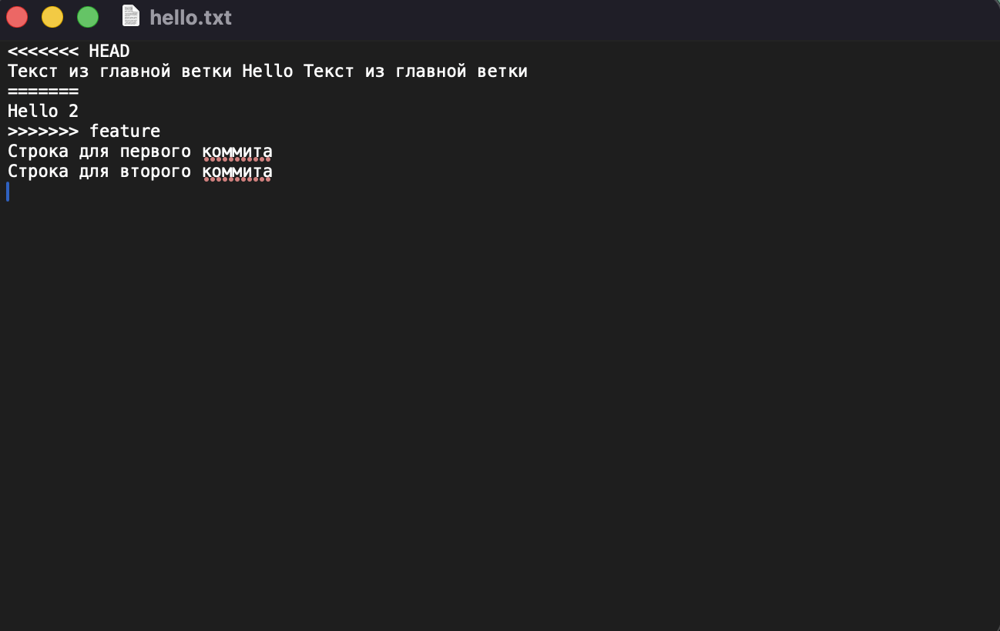

# Отчёт по лабораторной работе №6: Система контроля версий

**Студент:** Удалый Вчеслав (группа 4514)
**Цель работы:** Изучение базовых возможностей системы управления версиями, получение практического опыта работы с Git API, а также с локальным и удаленным репозиториями.

---

## 1. Подготовка окружения и базовая синхронизация
Был создан форк оригинального репозитория `LR6` в личный аккаунт на GitHub. Затем произведена настройка клиента Git (указаны имя пользователя и email) и клонирование удаленного репозитория на локальный компьютер.
Первый тестовый файл был создан через веб-интерфейс GitHub, после чего подтянуты эти изменения в локальный репозиторий с помощью команды `git pull`.


---

## 2. Работа с ветками и разрешение конфликта слияния
Для отработки конфликтов была создана побочная ветка `feature`. В ней модифицирован файл `hello.txt` и зафиксированы изменения. Затем переключение обратно в главную ветку `master`, где также отредактирована та же самая строка в файле `hello.txt` и сделан коммит. 

При выполнении команды `git merge feature` система остановила автоматическое слияние и выдала предупреждение о конфликте. 

**Процесс разрешения конфликта:**
Был открыт файл `hello.txt`. Git автоматически разметил конфликтные зоны служебными маркерами (`<<<<<<<`, `=======`, `>>>>>>>`), разделив версии из главной и побочной веток. 



Были ыручную удалены служебные маркеры и сформирован финальный вариант текста, объединивший изменения. В результате первые две строки файла приняли вид: 
`Текст из главной ветки Hello Текст из главной ветки`
`Hello 2`
    
После этого сохранен файл и завершено слияние командами `git add` и `git commit`. Побочная ветка `feature` была удалена командой `git branch -d feature`.


---

## 3. Фиксация новых изменений и откат (Revert)
После успешного слияния добавлены в файл `hello.txt` еще несколько строк через консоль, зафиксировав каждую отдельным коммитом:
- `Строка для первого коммита`
- `Строка для второго коммита`
- Третья строка, которая впоследствии была отменена.

Для безопасной отмены последнего коммита (добавления третьей строки) использована команду `git revert HEAD`. Это позволило зеркально откатить изменения в файле, создав новый коммит и не удаляя историю. 

Итоговое состояние файла `hello.txt` полностью подтверждает корректность выполненных действий — в нем присутствует текст, оставленный после разрешения конфликта, две добавленные строки, а третья строка отсутствует из-за успешного отката:


---

## 4. Лог выполненных команд
```bash
git config --global user.name "4514 Удалый В. П."
git config --global user.email "work2show@gmail.com"
git config --list
cd ~/Labs
git clone https://github.com/GigglyArtist/LR6.git
cd LR6
ls
git status
git pull
git branch
git checkout -b feature
git add hello.txt
git commit -m "Добавил текст в ветку feature"
git checkout master
git add hello.txt
git commit -m "Добавил конфликтный текст"
git log --oneline --graph --all
git merge feature
git add hello.txt
git commit -m "Разрешен конфликт слияния"
git branch -d feature
git branch
echo "Строка для первого коммита" >> hello.txt
git add hello.txt
git commit -m "Добавил первую строку"
echo "Строка для второго коммита" >> hello.txt
git add hello.txt
git commit -m "Добавил вторую строку"
echo "Строка для третьего коммита" >> hello.txt
git add hello.txt
git commit -m "Добавил третью строку"
git log --oneline
git revert HEAD --no-edit
git log --oneline
git checkout -b report
git add README.md
git add Lab6/
git commit -m "Начал оформление отчета, добавил скриншоты и лог команд"
git log --pretty=format:"%h - %ad - %an - %s" --date=short
```
